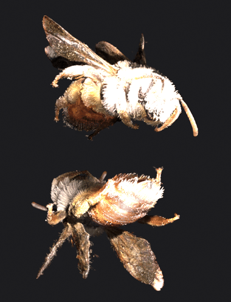
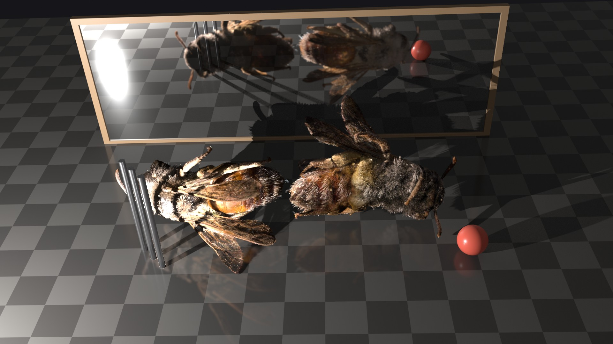
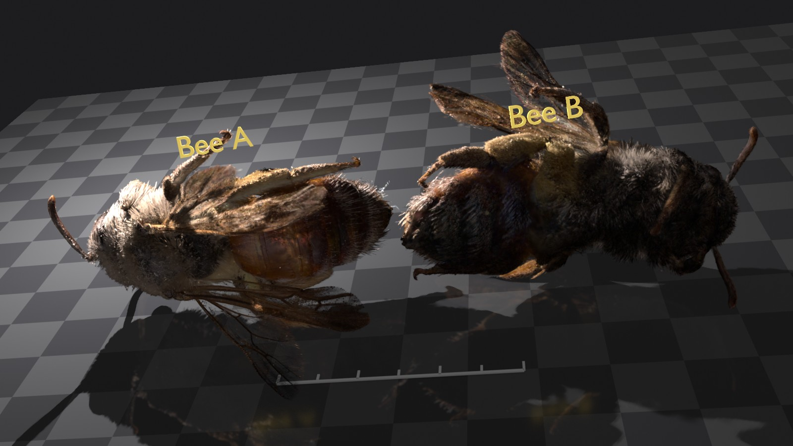

# Spirula Render (Blender 5.3+)

A Blender render engine that renders 3D Gaussian splat objects with
[Spirula Studio](https://github.com/harry7557558/spirula-studio)'s own rasterizer, the renderer the
models were trained with, instead of approximating them in EEVEE or Cycles.



Two copies of a 3-million-splat bee scan, end to end, relit by a point light orbiting them (72 frames, 1280x720,
about 22 s per frame with shadows on a MacBook Pro with M2 Pro). [MP4](docs/two_bees_orbit.mp4)

Pick **Spirula (3DGS)** as the render engine; F12 and Render Animation work as usual, from the scene
camera. Splats erased with the Gaussian Splat Patch add-on are left out.

Status: early. Final renders and the viewport's Rendered mode (perspective, orthographic and camera
view; renders at half resolution by default). Any number of splat objects (merged per frame in world
space, so they overlap and shadow each other), perspective scene cameras. macOS on Apple Silicon is
tested; Windows and Linux builds are experimental (see [Platforms](#platforms)).
With **Relight** on, the scene's lights light the splats, and the splats shadow themselves and each
other.

## Install

You need **Blender 5.3 or newer** and one of:

| System | Download | Status |
|---|---|---|
| macOS, Apple Silicon (M1 or later) | `spirula_render-<version>-macos-arm64.zip` | Tested |
| Windows 10/11, 64-bit, with a Vulkan GPU driver | `spirula_render-<version>-windows-x64.zip` | Experimental |
| Linux, 64-bit, with a Vulkan GPU driver | `spirula_render-<version>-linux-x64.zip` | Experimental |

1. Open the [latest release](https://github.com/timfennell/blender-splat-render/releases/latest) and
   download the zip for your system. Don't unzip it.
2. In Blender: **Edit > Preferences > Get Extensions**, open the **⌄** menu at the top right, choose
   **Install from Disk...** and pick the zip. (Dragging the zip onto the Blender window works too.)
   It's enabled straight away.
3. In **Render Properties**, set **Render Engine** to **Spirula (3DGS)**.
4. Import a splat model: **File > Import > Stanford PLY (.ply)** reads 3DGS PLY files (as exported
   by trainers such as Spirula Studio, Brush or SuperSplat) as point clouds.
5. Add a camera if the scene has none and press **F12**, or switch a 3D viewport to **Rendered**
   shading.

To **update**, install the newer zip the same way; it replaces the old version (restart Blender
afterwards, since the renderer library stays loaded). To **remove** it: **Preferences > Add-ons >
Spirula Render > ⌄ > Uninstall**.

**If it doesn't work:**

- *"The renderer library is missing"*: the zip is for another system; download the one for yours.
- Windows/Linux: the renderer needs a Vulkan GPU driver (any current NVIDIA, AMD or Intel driver
  has one; `vulkaninfo` from the Vulkan SDK shows it). Please
  [open an issue](https://github.com/timfennell/blender-splat-render/issues) with what you see:
  those builds haven't been tried on a real Windows or Linux machine yet.
- Meshes in a scene are rendered through Blender's own Cycles, which must stay enabled (it is
  by default).

## Platforms

The renderer is Spirula Studio's, as a library with a small C interface; the rest of the add-on is
Python and Blender's own GPU API, the same on every system. Each release has one zip per system,
built on GitHub Actions from upstream Spirula Studio plus the patch in `spirula_patch/`:

- **macOS (Apple Silicon):** MoltenVK linked in. Tested on an M2 Pro.
- **Linux (x64):** built and tested on GitHub's runners with a software Vulkan device (Mesa
  lavapipe), which checks it renders correctly, not how it runs on a real GPU.
- **Windows (x64):** built on GitHub's runners and checked to load; not yet run on a real machine.

Reports from Windows and Linux users are very welcome.

## Depth of field

Turn on the camera's Depth of Field (Camera properties) as for any Blender render: focus distance
or focus object, f-stop, blades. Final renders then render the splats from **Depth of Field
Samples** points across the lens (Spirula panel, default 32) and average them, so out-of-focus fur
blurs over what's behind it as a real lens would. Relighting is done once per frame; each sample
is one more splat render (about 0.3 s for a 3M-splat model at 1080p). Meshes are rendered sharp by
Cycles and moved to each lens point by their depth, so they blur with the splats and meet them
correctly in every sample. The viewport doesn't show depth of field; the render window shows the
blur building up every 8 samples.

Blur depends on the scene's real size: Blender works out the lens opening from the focal length
and f-stop in metres. A scan imported at its training scale (a 13 mm bee that is 13 units long)
needs **Scene > Units > Unit Scale** set to its real size per unit (0.001 if a unit is a
millimetre), or the lens is far too small to blur anything. Strong blur needs more samples
(64-128) to stay smooth.

## Meshes alongside the splats



One final render, one point light at the front left:

- **Meshes shadow splats:** the three slats cast stripes across the left bee's fur.
- **Splats shadow meshes:** both bees cast soft fur shadows across the floor.
- **Splats shadow splats:** the left bee shades the right one, and each shades itself.
- **Splats in a mirror:** the mirror shows the bees' backs, a side the camera can't see.
- **Light off the mirror:** the lamp's light bounces off the mirror onto the bees' backs (Mirror
  Light: each light's image behind a mirror or polished metal plane, shining through its outline,
  shadowed by the splats and meshes in front of it). It lights the splats only; meshes get no
  bounced light from mirrors.
- **Splats in a glossy floor:** the bees are reflected, blurred by the floor's roughness.
- **Meshes in meshes (Cycles):** the ball, slats and frame are reflected in the floor and the mirror.



Polygon objects (planes, text, rulers, frames, any mesh) render with the splats. In final renders
they're path traced by Blender's own Cycles, run inside this engine, so their materials, textures
and mesh-on-mesh shadows and reflections are Cycles'. The engine joins them up with the splats:

- **Depth:** meshes and splats meet per pixel, so fur in front of a plane stays in front of it.
- **Splats shadow meshes:** each light's contribution on a mesh is dimmed by the splats' own shadow
  maps (the ones the splats shadow themselves with), so fur casts soft, see-through shadows.
- **Meshes shadow splats:** mesh triangles are drawn into each light's shadow map.
- **Reflections:** flat shiny meshes (floors, mirrors) reflect the splats, as strongly as their
  material reflects and blurred by its roughness. Curved meshes don't reflect the splats.
- **Always on Top** (Object properties > Spirula): draws a mesh over the splats even where they're
  in front of it, for labels, rulers and highlight frames.

Cycles never sees the splats (they're hidden from its rays while it renders), and its lights are
converted to this engine's units, so a light gives a mesh and a splat the same brightness. Mesh
samples, device and denoising are in the Spirula render panel.

The viewport draws a fast GPU preview of the meshes (base colour or image texture, the same lights,
the splats' shadows on them, their shadows on the splats). Mesh-on-mesh shadows and reflections are
final-render only.

The renderer library is built from a branch of Spirula Studio (`blender-render`, target
`spirula_render`), which adds a small C interface (`src/blender/SplatRenderC.cpp`).

## Building the renderer library

The library in each release zip is built from
[Spirula Studio](https://github.com/harry7557558/spirula-studio) (GPL-3.0) at the upstream commit in
`spirula_patch/UPSTREAM_BASE.txt`, plus `spirula_patch/spirula-local-changes.patch` (which adds the C
interface `src/blender/SplatRenderC.cpp` and the `spirula_render` CMake target).
`.github/workflows/build.yml` does this on every tag for all three systems. By hand, with the
Vulkan SDK (Windows, Linux) or Xcode tools (macOS), CMake and Ninja:

```bash
git clone https://github.com/harry7557558/spirula-studio spirula && cd spirula
git checkout "$(cat ../spirula_patch/UPSTREAM_BASE.txt)"
git apply ../spirula_patch/spirula-local-changes.patch
cmake -G Ninja -B build -DCMAKE_BUILD_TYPE=Release -DSS_BACKEND=vulkan -DSS_ENABLE_PATENTED=ON
cmake --build build --target spirula_render
cd .. && python tools/smoke_test.py spirula/build/libspirula_render.so   # optional test render
python tools/package.py --lib spirula/build/libspirula_render.so --platform linux-x64
```

(On Windows the library is `spirula/build/spirula_render.dll` and the platform `windows-x64`, built
from a Visual Studio developer prompt; on macOS `libspirula_render.dylib` and `macos-arm64`.)

License: GPL-3.0-or-later.
